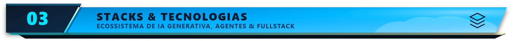

  

 

---

  

Engenheiro de Software na **Usabit**, focado em **agentes de IA e automação**. Conecto modelos generativos a processos reais de negócio: qualificação de leads, campanhas de marketing e atendimento automatizado. Baseado no Rio de Janeiro.

> *"Transformo fluxos complexos em agentes que pensam, decidem e executam."*

---

  

| Projeto | O que faz | Stack |
|---|---|---|
| 🤖 [**Diário de Engenharia**](https://github.com/Fabrycio13/Relatorios-IA) | Coleta novidades sobre Coding Agents, resume com LLMs e envia um relatório diário por e-mail | Python · N8N · GitHub Actions |
| 🔍 [**GitHub Intelligence**](https://github.com/Fabrycio13/github-intelligence) | CLI e dashboard que auditam repositórios e geram relatórios baseados em evidências | Python · PostgreSQL · Supabase |
| 🧑‍💼 [**Usabit People**](https://github.com/Fabrycio13/ia_rh_usabit) | Triagem de candidatos com score por IA e pipeline Kanban do processo seletivo | React · TypeScript · Supabase · OpenAI |
| 📑 [**MDS Crédito Imobiliário**](https://github.com/Fabrycio13/project-mds) | Gera laudos e simulações de financiamento imobiliário em PDF | JavaScript · Vite · jsPDF |
| 🌐 [**Portfólio Web**](https://fabrycio.vercel.app/) | Meu site pessoal, com animações em canvas ([código](https://github.com/Fabrycio13/portifolio_fabrycio)) | TypeScript · Canvas · Vercel |

<b>💼 Cases corporativos</b> (código privado)

 

- **Cindy Condômino**: agente de WhatsApp para condomínios, com RAG e dados isolados por condomínio. [Documentação](docs/projects/cindy-condominio.md)
- **Dashboard Meta Ads + IA**: KPIs de campanhas, Kanban de leads e feedback de cada anúncio gerado por IA. [Documentação](docs/projects/meta-ads-dashboard.md)
- **Análise de Extratos**: lê PDFs bancários e monta o perfil financeiro para análise de crédito.
- **Diagnóstico Digital**: questionário com síntese por IA, enviado direto para o RD Station CRM.
- **Gestor Financeiro**: categoriza despesas automaticamente e gera insights com IA.

---

  

**IA & Automação**

**Desenvolvimento**

---

  

---

  

- **Engenheiro de IA & Automação** @ Usabit · *mai/2024 – hoje*
- **Antes:** 5 anos em áreas administrativa e financeira (Grupo Frigoforte e Power Flex), onde aprendi na prática regras de negócio, fluxo de caixa e análise de crédito.

🎓 Engenharia de Software · Universidade Estácio de Sá (2024) 
🌎 Português nativo · Inglês intermediário · Espanhol básico
