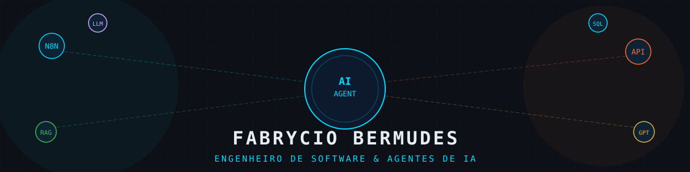

<div align="center">



<br /><br />

[](https://git.io/typing-svg)

<br />

[](https://fabrycio.vercel.app/)
[](https://linkedin.com/in/fabrycio.bermudes)
[](https://wa.me/5521986866460)
[](mailto:bermudes.fbc@gmail.com)


</div>

---

## 🧠 Sobre Mim

Sou um **Engenheiro de Software** especializado em **Engenharia de IA**, **Coding Agents** e **automação inteligente**. Atualmente na **Usabit**, projeto e construo arquiteturas corporativas de ponta a ponta conectando modelos generativos a fluxos de negócio reais — desde a qualificação analítica de leads e automação de campanhas até agentes multi-tenant de atendimento e triagem.

> *"Transformo fluxos complexos em agentes que pensam, decidem e executam."*

---

## 🚀 Projetos em Destaque

### 🤖 [Diário de Engenharia: IA & Coding Agents](https://github.com/Fabrycio13/Relatorios-IA)
> Automação ponta a ponta para curadoria, síntese analítica por IA e entrega diária por e-mail sobre o ecossistema de Coding Agents, papers e ferramentas open-source.

- ⚙️ Pipeline autônomo com web scraping, curadoria de tendências e sintetização analítica via LLMs
- 🏛️ Engenharia de ponta documentada: vocabulário ubíquo ([GLOSSARY.md](https://github.com/Fabrycio13/Relatorios-IA/blob/main/GLOSSARY.md)), mapa de arquitetura técnica e registros formais de decisão (ADRs)
- 📬 Distribuição automatizada de relatórios executivos formatados diretamente por e-mail
- 🛠️ **Stack:** Python · N8N · Multi-Agent Architecture · LLMs · GitHub Actions · Email Automation
- 🔗 **Acessos:** [](https://github.com/Fabrycio13/Relatorios-IA)

---

### 🔍 [GitHub Intelligence — CLI & Evidence Dashboard](https://github.com/Fabrycio13/github-intelligence)
> Ferramenta determinística de monitoramento e auditoria de repositórios GitHub com geração de relatórios baseados em evidências.

- 📊 Coleta auditável e somente-leitura de métricas e atividades do GitHub via App API
- 📋 CLI determinística com relatórios em Markdown e dashboard local com sidebar interativa
- 🔒 Persistência opcional em PostgreSQL / Supabase operando com schema restrito e políticas de segurança
- 🛠️ **Stack:** Python · PostgreSQL · Supabase · GitHub Apps API · Rich CLI · Data Evidence
- 🔗 **Acessos:** [](https://github.com/Fabrycio13/github-intelligence)

---

### 🌐 [Portfólio Web Imersivo](https://fabrycio.vercel.app/)
> Experiência visual interativa de alta performance apresentando projetos, serviços e canais de contato com motion design.

- ⚡ Renderização ultra-otimizada com carregamento por proximidade do viewport
- 🎨 Transições fluidas em canvas, navegação suave e tipografia animada
- 🛠️ **Stack:** JavaScript · TypeScript · CSS Moderno / Canvas · Vercel
- 🔗 **Acessos:** [](https://fabrycio.vercel.app/) · [](https://github.com/Fabrycio13/portifolio_fabrycio)

---

### 🤖 Cindy Condômino — Agente IA Multi-Tenant
> Agente conversacional completo para gestão condominial integrado ao WhatsApp e dashboard web.

- 🏠 Cadastro de moradores, veículos e encomendas via chat natural
- 📚 RAG com documentos específicos e isolados por condomínio
- 🔀 Arquitetura multi-tenant com isolamento estrito de dados no Supabase
- 🛠️ **Stack:** React · TypeScript · Supabase · Edge Functions · RAG · WhatsApp API
- 🔗 **Acessos:** [](docs/projects/cindy-condominio.md) · `[Case Corporativo]`

---

### 📊 Dashboard Meta Ads + IA — Usabit
> Painel analítico de alta performance para monitoramento estratégico de campanhas do Meta Ads.

- 📈 KPIs em tempo real: Spend, Reach, CTR, CPC, CPM
- 🗂️ Kanban de leads integrado com sincronização automática no Google Sheets
- 🤖 Feedback automatizado via IA avaliando performance individual de cada anúncio
- 🛠️ **Stack:** Next.js 15 · Tailwind CSS v4 · TypeScript · Meta Ads API
- 🔗 **Acessos:** [](docs/projects/meta-ads-dashboard.md) · `[Case Corporativo — Usabit]`

---

### 🧑‍💼 [Space Talent AI — RH Inteligente](https://github.com/Fabrycio13/ia_rh_usabit)
> Plataforma de recrutamento e seleção com IA para triagem rápida, score de candidatos e pipeline visual.

- 🎯 Score automático de compatibilidade baseado em currículos via modelos de IA
- 📋 Pipeline Kanban visual e fluido do processo seletivo
- 💬 Assistente IA integrado para apoio em decisões e automações
- 🛠️ **Stack:** React · TypeScript · Vite · Supabase · OpenAI
- 🔗 **Acessos:** [](https://github.com/Fabrycio13/ia_rh_usabit) · [](docs/projects/space-talent-ai.md)

---

### 🔬 Outras Soluções de Automação & IA

| Solução | Descrição | Tecnologias |
|---|---|---|
| 🏦 **Análise Inteligente de Extratos** | Pipeline que processa PDFs bancários e sintetiza perfil financeiro para crédito | N8N · OpenAI GPT · PDF Parser |
| 📋 **Diagnóstico Digital Automatizado** | Coleta diagnóstica com síntese por IA e sincronização direta no RD Station CRM | N8N · RD Station · REST API |
| 💰 **Gestor Financeiro com IA** | Dashboard inteligente com categorização autônoma de despesas e geração de insights | N8N · Supabase · GPT |

---

## ⚙️ Stack de IA, Coding Agents & Automação

[](https://n8n.io/)
[](https://openai.com/)
[](https://ai.google.dev/)
[](https://anthropic.com/)
[](https://en.wikipedia.org/wiki/Retrieval-augmented_generation)
[](https://github.com/topics/multi-agent-systems)
[](https://business.whatsapp.com/)
[](https://developers.facebook.com/docs/marketing-apis/)
[](https://www.python.org/)

## 🛠️ Stack de Desenvolvimento Fullstack

[](https://www.typescriptlang.org/)
[](https://developer.mozilla.org/en-US/docs/Web/JavaScript)
[](https://nextjs.org/)
[](https://reactjs.org/)
[](https://nodejs.org/)
[](https://supabase.com/)
[](https://www.postgresql.org/)
[](https://redis.io/)
[](https://tailwindcss.com/)
[](https://git-scm.com/)

---

## 📊 Estatísticas do GitHub

<div align="center">


<br /><br />

[](https://git.io/streak-stats)

</div>

---

## 🏆 Trajetória Profissional

```
📅 Mai 2024 – Presente   |  Engenheiro de IA & Automação @ Usabit
   └─ Arquitetura de Agentes · N8N · RAG · Multi-Agent Systems · Meta Ads API

📅 2019 – 2023            |  Assistente Administrativo @ Grupo Frigoforte
   └─ Controle financeiro · Fluxo de caixa · CNAB · Regras de negócio corporativas

📅 2018 – 2019            |  Auxiliar Administrativo @ Power Flex Distribuidora
   └─ Faturamento · Análise de crédito · Catálogos digitais · Gestão de estoque
```

---

## 🎓 Formação Acadêmica

```
🎓 Bacharelado em Engenharia de Software — Universidade Estácio de Sá (2019–2024)
🎓 Técnico em Administração — Instituto Geremário Dantas (2006)
```

---

## 🌎 Idiomas


---

<div align="center">

### 🤝 Vamos conversar ou construir algo juntos?

Seja para discutir arquiteturas de **Coding Agents**, **Pipelines com IA Generativa** ou oportunidades em engenharia de software:

[](https://fabrycio.vercel.app/)
[](https://linkedin.com/in/fabrycio.bermudes)
[](https://wa.me/5521986866460)

<br />


*Construindo o futuro com agentes que pensam, decidem e executam.* 🤖

</div>